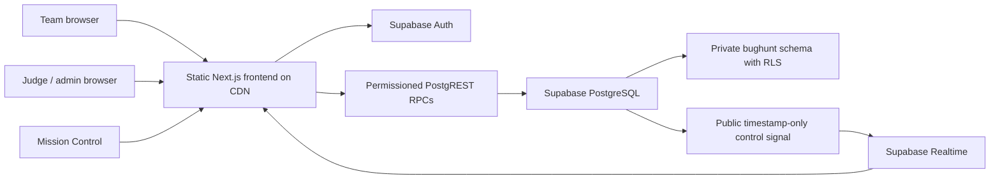

# Architecture and security

The frontend is a static Next.js/React export. It has no server service key or application database connection. Supabase Auth handles credentials, email confirmation, token issuance, recovery, and refresh. PostgreSQL functions are the application server: every private entry point verifies `auth.uid()`, the JWT session ID, the corresponding `auth.sessions` record, and role or team ownership. Team mutations also require an active competition lease.

All competition tables live in a schema with no anonymous/authenticated USAGE or table grants. RLS is enabled on every table with explicit deny-direct-access policies. Authorized security-definer RPCs return only the data appropriate for the caller, fix `search_path`, use qualified object names, and have explicitly revoked default PUBLIC EXECUTE privileges. The only public table is a timestamp-only realtime invalidation signal with read-only grants and explicit RLS policies. It contains no questions, keys, identities, or scores.

Admin and judge roles come from a protected database allowlist and staff table, never from client metadata. Email reservations activate only after the matching Auth email is confirmed. No staff credentials are shipped in the frontend. Answer keys and unreleased questions are never returned by participant/public endpoints. Participant submission responses hide scores and solutions during the event.

## Concurrency and integrity

- An answer mutation locks that team's row; unrelated teams proceed independently. Attempt allocation and insert happen in one transaction with unique team/question/attempt and request-ID constraints.
- A round read lock protects its state while a mutation checks the database timestamp and deadline. Organizer pause/close takes the conflicting lock. A response arriving late does not imply a late acceptance: the transaction's authoritative timestamp decides.
- Pause/resume moves only unfinished deadlines that were still valid at pause time. Reopen requires an explicit additional-time grant and reason. A completed team round stays locked.
- Optimistic draft revisions detect cross-device overwrites and recognize an identical retry after a lost response.
- Claims are verified once. A unique team/bug constraint prevents duplicate points; a unique critical-bug row awards only one first-fix bonus globally. Rejected claims use unique penalty sources.
- Team scores are recalculated at mutation time from best judged attempts, verified claims, bonuses, and adjustments. Public leaderboard reads indexed team scores instead of grading or aggregating every answer on each refresh.
- Organizer and judge changes append an audit entry in the same transaction. Browser roles cannot edit or delete audit records. Database operators retain administrative privileges; this is an application-immutable audit trail, not a cryptographically tamper-proof ledger.
- Finalization rejects pending reviews and open rounds, freezes scoring, publishes results, and issues stable certificate IDs.

## Traffic behavior

There is no per-second timer request: displays advance from a server time anchor using `performance.now()`. Team state refreshes at staggered 18–24-second intervals, with a 45-second session heartbeat. Draft writes debounce after 1.8 seconds of inactivity. Public refreshes are staggered at 15–20 seconds. Organizer controls invalidate connected screens using one public realtime timestamp; normal score writes do not fan out notifications to every contestant. Polling continues if realtime connections are unavailable.

500 active teams imply roughly 21–28 state reads/second and 11 heartbeats/second before answer activity. Avoiding a whole-event lock for contestant writes, indexing owner/queue/ranking lookups, bounding all input and response collections, and shipping immutable static assets reduces contention. The local 500-team test is evidence about these database operations; production latency also depends on Supabase compute, connection pools, quota, network, and email infrastructure.

## Limits and deployment inputs

There is no arbitrary code execution, practical lab, or automated hidden-test sandbox. Judges verify written fixes. Certificates use the browser's print-to-PDF capability, with persistent database verification IDs and QR links. Backup/PITR and SMTP are infrastructure settings; the application cannot enable them with a publishable or service key. The event's date, institution, branding, staff roster, and hosting audience remain organizer settings or operational decisions.

The provided header policy uses inline script/style allowances required by the static Next.js export and UI primitives. It blocks objects and limits connections to Supabase, and must be validated on the actual hosting platform. Keep dependencies patched and run security review before an event involving personal information.
